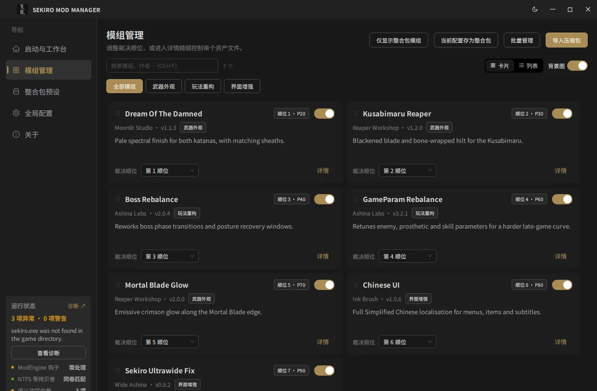
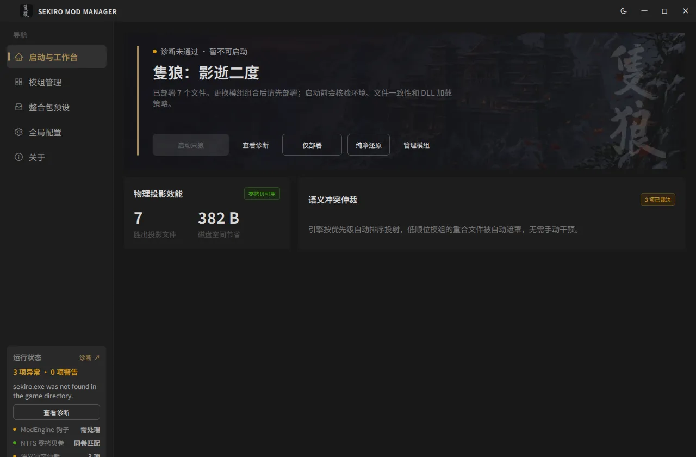
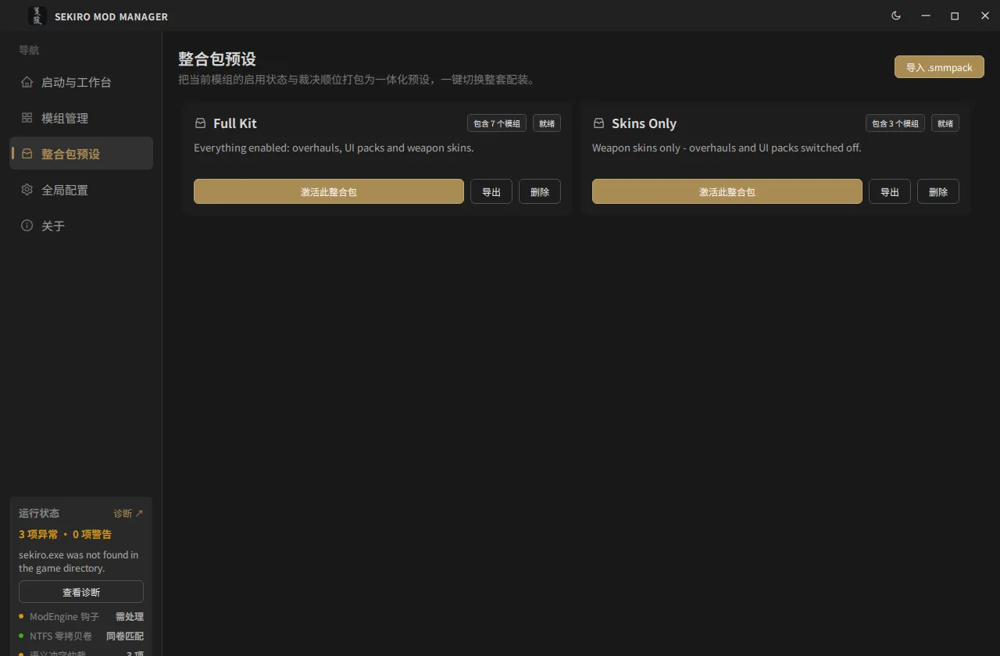
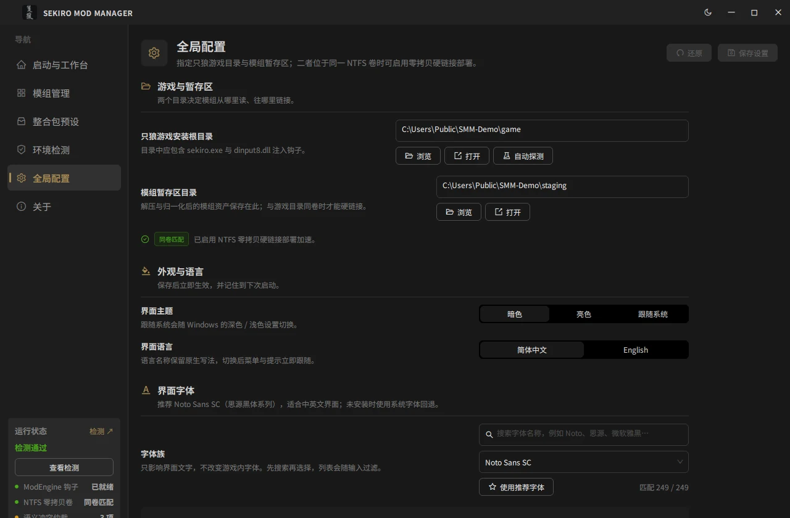
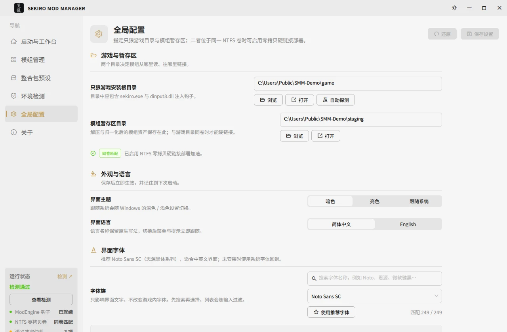
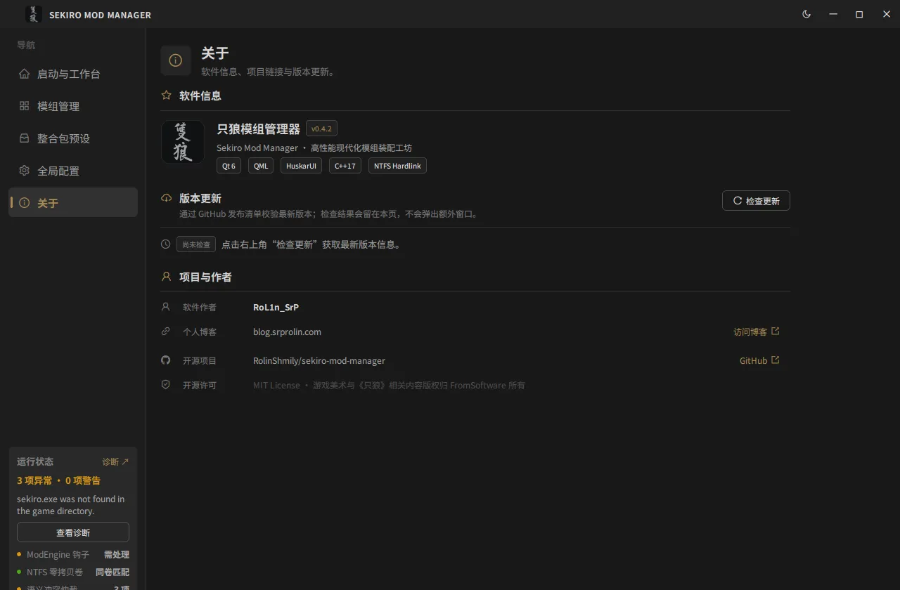

<h1 align="center">Sekiro Mod Manager</h1>

  <b>English</b> | <a href="README.zh-CN.md">简体中文</a>

  
  
  
  
  
  

  

More screenshots · Launch Hub, Mod Packs, Settings (Dark & Light), About

- **Launch Hub**: 
- **Mod Packs (`.smmpack`)**: 
- **Settings (Dark / Light)**:  
- **About**: 

**Sekiro Mod Manager (SMM)** is a native C++17 / Qt 6 Windows desktop mod manager for *Sekiro: Shadows Die Twice* that stages mods cleanly and deploys them into `mods/` via **NTFS hard links**—zero extra disk space, instant switching, and pristine rollback.

- **Zero-Copy NTFS Hard Links & Pristine Rollback**: Projects active assets into `<Sekiro>/mods/` with `CreateHardLinkW` (automatic copy fallback across volumes) and tracks every file in `.smm_manifest.json` so restore leaves the game untouched.
- **Smart Normalization & 3-Tier Conflict Arbitration**: Imports `.zip` / `.7z` / `.rar` / folders (nested up to 6 levels), routes loose Sekiro files (`parts/`, `chr/`, `param/`, `menu/font/`…), and resolves Critical / Warning / Info overlaps by priority.
- **Portable `.smmpack` Mod Packs**: Snapshot enabled mods and priority order into one-click presets or shareable `.smmpack` archives; browse optional community starter packs on [sekiro.srprolin.com](https://sekiro.srprolin.com/) for quick onboarding.
- **Built-in Environment Doctor**: Verifies `sekiro.exe`, ModEngine `dinput8.dll`, `modengine.ini`, staging volume, and deployment consistency with one-click repair. Never bundles or modifies game binaries.

## Usage

### 1. Download & Launch

Download the installer (`setup.exe`) or portable bundle (`gui.zip`) from [sekiro.srprolin.com](https://sekiro.srprolin.com/) (CDN mirror + GitHub direct) or [GitHub Releases](https://github.com/RolinShmily/sekiro-mod-manager/releases). Launch **Sekiro Mod Manager** (UAC elevation is requested once at startup so ModEngine's local `dinput8.dll` is honoured by Steam).

### 2. Import, Order & Resolve

1. **Settings / Diagnostics**: Confirm your Sekiro directory and staging directory (keep them on the same NTFS drive for zero-copy hard links) and run the 5-item environment check.
2. **Mod Library**: Drag-and-drop mod archives, folders, or `.smmpack` bundles. Toggle mods or individual assets, drag/adjust priority (lower number wins shared files), and inspect conflict badges.
3. **Mod Packs**: Save your active loadout as a preset or import a `.smmpack` bundle in one click.

### 3. Deploy & Launch

Click **Deploy** (or **Deploy & Launch**) from the Launch Hub. SMM verifies the environment, updates `mods/` atomically against `.smm_manifest.json`, and launches Sekiro. Click **Restore** anytime to return to a vanilla install.

> **ModEngine notice**: SMM detects and configures `modengine.ini`, but **never distributes `dinput8.dll`**. Obtain an unmodified copy of ModEngine directly from [Nexus Mods #6](https://www.nexusmods.com/sekiro/mods/6).

## Documentation

| Document | Scope |
| :--- | :--- |
| [`docs/architecture.md`](docs/architecture.md) | Layer boundaries, flat `src/core`, GUI backend threading, Worker release proxy & R2 modpack flow |
| [`docs/design.md`](docs/design.md) | Desktop UI structure, HuskarUI tokens, preview cross-fade, bilingual i18n & screenshots |
| [`docs/reference.md`](docs/reference.md) | On-disk schemas (`.smm_mod.json`, `.smmpack`, `.smm_manifest.json`), `ErrorCode` table & `smm_core` API |
| [`docs/development.md`](docs/development.md) | Local CMake/Qt build, `tests/` suites, packaging, CI/CD (`test`/`build`/`release`/`deploy`) & website dev |

Also see [`CONTRIBUTING.md`](CONTRIBUTING.md), [`THIRD_PARTY_NOTICES`](THIRD_PARTY_NOTICES), and [`CHANGELOG.md`](CHANGELOG.md).

## License & Disclaimer

MIT — Copyright (c) 2025–2026 **RoL1n_SrP**. See [`LICENSE`](LICENSE) and [`THIRD_PARTY_NOTICES`](THIRD_PARTY_NOTICES).

*Sekiro: Shadows Die Twice is a registered trademark of FromSoftware, Inc. and Activision. SMM is an independent open-source tool not affiliated with or endorsed by FromSoftware or Activision. Third-party community mods and any optional community `.smmpack` showcase bundles remain the property of their respective authors under their original terms.*
