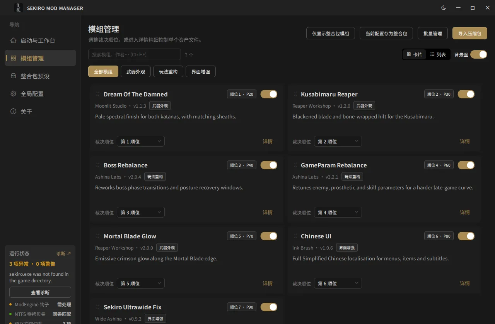
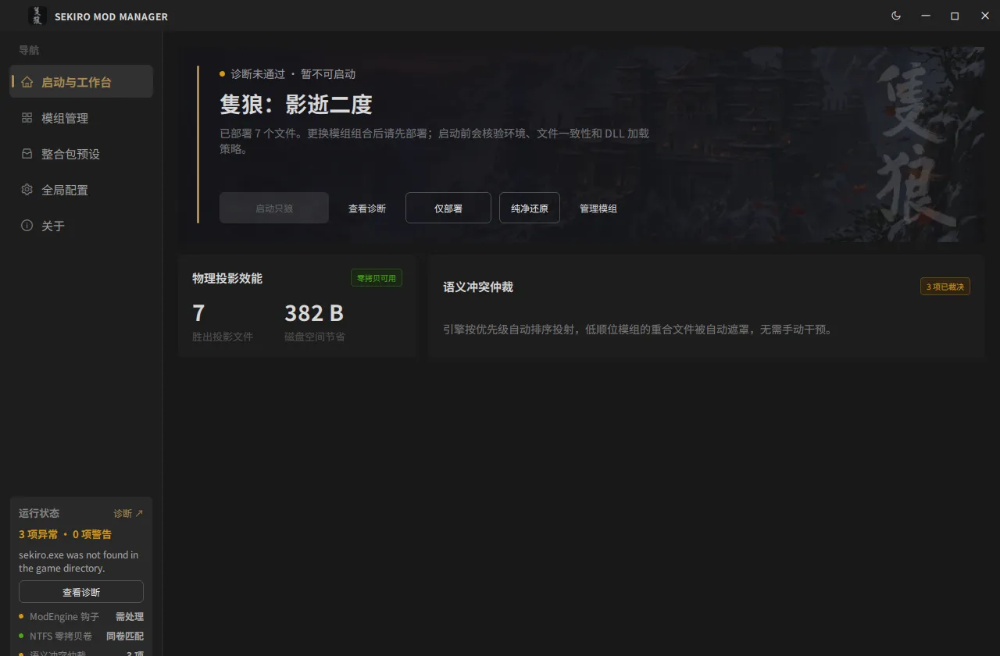
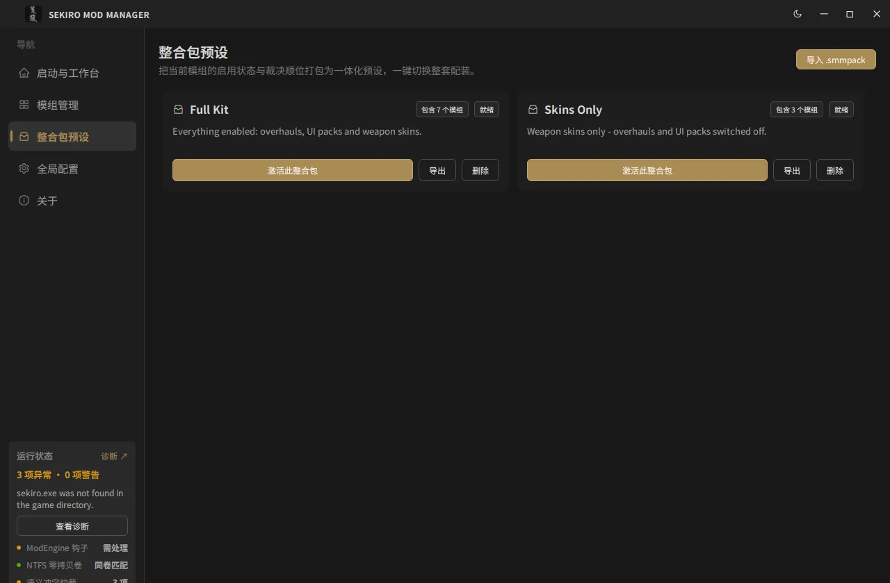
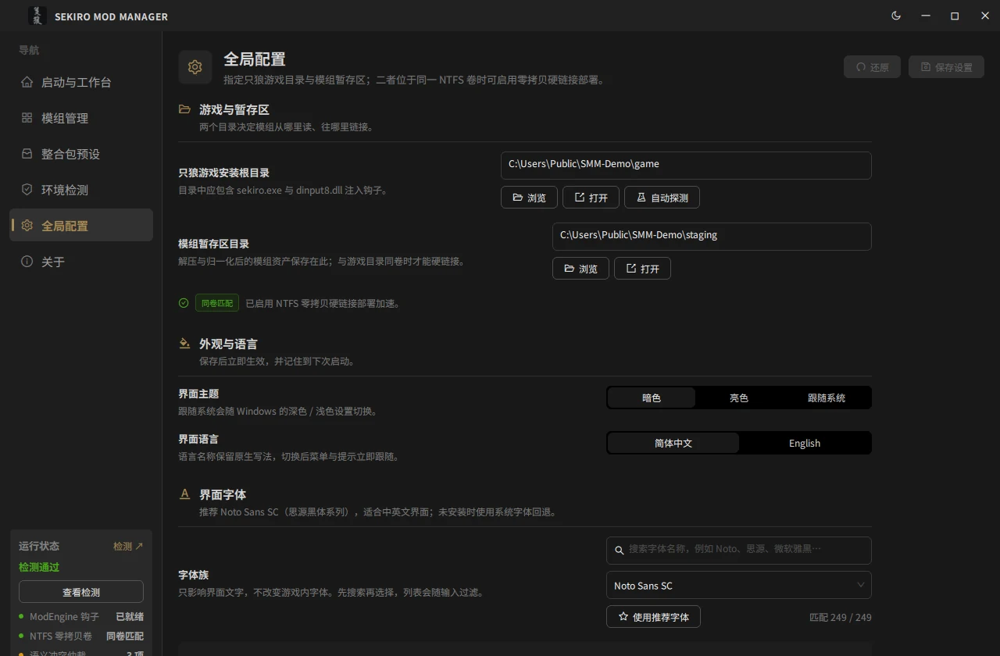
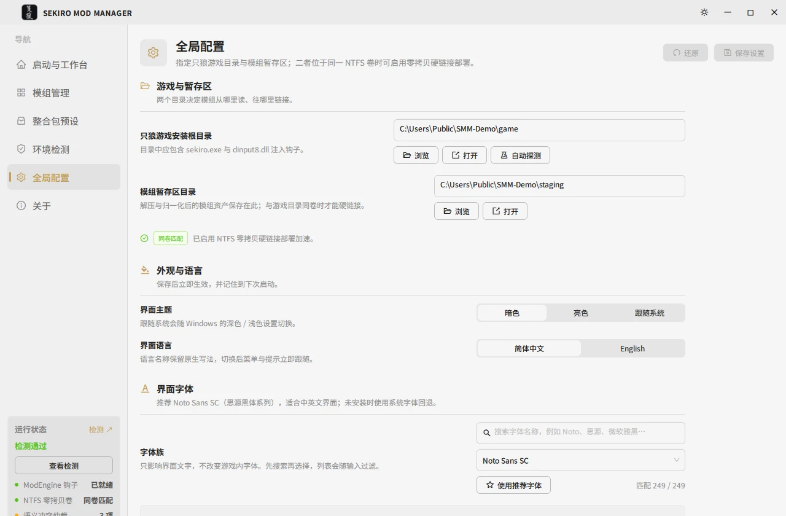
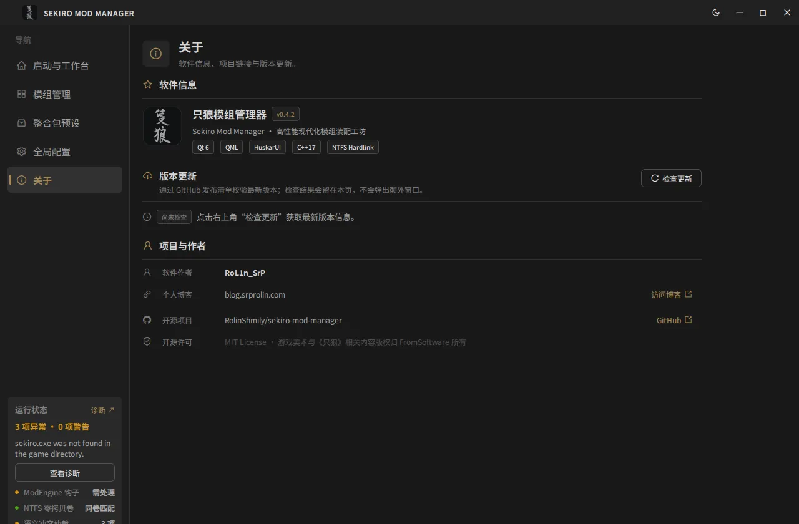

# Sekiro Mod Manager (SMM)

High-performance mod staging, semantic conflict arbitration, and zero-copy NTFS deployment for *Sekiro: Shadows Die Twice*.

[English](README.md) | [简体中文](README.zh-CN.md) | [Website](https://sekiro.srprolin.com/) | [Documentation](docs/README.md)

---

## Overview

Sekiro Mod Manager keeps mods in an isolated staging area and projects the active ones into
the game's `mods/` directory with **NTFS hard links**, so deploying tens of gigabytes is
instant, costs no extra disk space, and can be rolled back to a pristine install. It is a
native C++17 / Qt 6 QML desktop app, a standalone CLI, and an agent skill built on the same
core library.

## Key Features

| | |
|---|---|
| **Zero-copy deployment** | `CreateHardLinkW` on the same volume; automatic copy fallback across volumes with diagnostics. |
| **Pristine rollback** | Every deployment is tracked in `.smm_manifest.json`; restore removes only what SMM created. |
| **Normalisation** | Arbitrary Nexus/community folder layouts, archives nested up to 6 levels, loose signature files routed to `parts/`, `chr/`, `menu/font/`…, unpacking scaffolding removed. |
| **Conflict arbitration** | Three severities — critical (balance tables), warning (exclusive player/weapon slots), info (general overrides) — resolved by user-assigned priority. |
| **Mod packs** | `.smmpack` presets with bilingual titles, exportable/importable as portable archives. |
| **Asset-level control** | Inspect a staged mod's files and toggle individual assets, with per-mod backdrop artwork. |
| **Environment doctor** | A page (not a dialog) with five checks — `sekiro.exe`, ModEngine `dinput8.dll`, `modengine.ini`, staging, deployment — plus one-click repair. |
| **Bilingual UI** | Live switching between `zh-CN` and `en-US`, plus a dark/light/system theme. |

## Interface



The mod library is the working screen: priority order (lower number wins a shared file), per-mod
toggles, category filters, and the conflict badge that opens the detail drawer. The other four
screens:

<details>
<summary>Launch hub · Mod packs · Settings (dark and light) · About</summary>

<table>
<tr>
<td></td>
<td></td>
</tr>
<tr>
<td><b>Launch hub</b> — one verdict (deployed files, conflicts) plus the evidence behind it. Pressing <i>Launch</i> runs the five environment checks first and only starts the game when they pass.</td>
<td><b>Mod packs</b> — snapshots of "enabled set + priorities", switchable in one click and portable as <code>.smmpack</code> archives.</td>
</tr>
<tr>
<td></td>
<td></td>
</tr>
<tr>
<td><b>Settings</b> — game and staging roots (with the same-volume hard-link hint), theme, language and font. Each setting is a two-column row: label and explanation on the left, the control aligned in one column on the right.</td>
<td><b>Settings, light theme</b> — the same tokens, not a second palette; this is where button contrast on artwork gets checked.</td>
</tr>
</table>



</details>

Every screenshot is taken against the fictional demo library from `scripts/local/seed_demo.ps1`,
not a real install, and can be regenerated with `scripts/local/capture_screenshots.ps1` — see
[docs/design/screenshots.md](docs/design/screenshots.md).

## Architecture

```
                    smm_core   (C++17, no Qt, no printing)
                        ▲
          ┌─────────────┴─────────────┐
       smm.exe                     smm_gui.exe
       CLI + JSON API              Qt 6 / QML + HuskarUI
                                   controller → service → core
```

Both entry points are independent processes that link the same static library. The GUI adds a
Qt-only adaptation layer (`src/gui/backend/`); the CLI owns argument parsing, table/JSON
output and exit codes. Details: [docs/architecture/layers.md](docs/architecture/layers.md).

## Quick start

Prerequisites: Windows 10/11 x64, Visual Studio 2022 (MSVC v143), CMake 3.25+, Qt 6.11.2,
Python 3.9+ (skill packaging and the HuskarUI patch).

```bash
git clone --recurse-submodules https://github.com/RolinShmily/sekiro-mod-manager.git
cd sekiro-mod-manager
cmake --preset msvc-x64-release && cmake --build --preset build-release
```

Outputs: `build/msvc-x64-release/src/cli/smm.exe` and `.../src/gui/smm_gui.exe`.
Presets, incremental builds, `core-only` (no Qt) builds and troubleshooting:
[docs/development/build.md](docs/development/build.md).

## CLI at a glance

```bash
smm doctor                       # environment + ModEngine health
smm list                         # staged mods, priority, conflicts
smm import ~/Downloads/mod.zip   # stage an archive or folder
smm plan && smm deploy           # preview, then hard-link into mods/
smm restore                      # return the game install to pristine
```

Full command/option/exit-code reference: [docs/reference/cli.md](docs/reference/cli.md).
Machine-readable output (`--json`) contract: [docs/reference/json-contract.md](docs/reference/json-contract.md).

`smm.exe` declares `requireAdministrator`, like the desktop app. Windows cannot raise UAC from
`CreateProcess`, so run it from an elevated terminal — `smm doctor` in a normal terminal fails with
`ERROR_ELEVATION_REQUIRED` (740) and no prompt. `start smm ...` does elevate from a normal terminal,
but its output lands in a new window.

## Documentation

Documentation is written in Chinese; the index lives at [docs/README.md](docs/README.md).

| Section | Covers |
|---|---|
| [architecture/](docs/architecture/README.md) | Layer boundaries, GUI backend roles, async/threading model, main data flows, decision log. |
| [design/](docs/design/README.md) | Design tokens, reusable QML components, the no-motion rule, i18n and accessibility. |
| [development/](docs/development/README.md) | Environment and presets, coding style, test suites, branch/commit/PR workflow. |
| [reference/](docs/reference/README.md) | CLI reference, JSON contract, error codes, on-disk formats, `smm_core` header index. |

Contributor quick guide: [CONTRIBUTING.md](CONTRIBUTING.md).

## Licensing & Trademarks

- SMM source code is licensed under the [MIT License](LICENSE).
- Third-party dependencies and notices are detailed in [THIRD_PARTY_NOTICES.md](THIRD_PARTY_NOTICES.md) and [LICENSING.md](LICENSING.md).
- *Sekiro: Shadows Die Twice* is a registered trademark of FromSoftware, Inc. and Activision. SMM is an independent community project not affiliated with FromSoftware or Activision.
