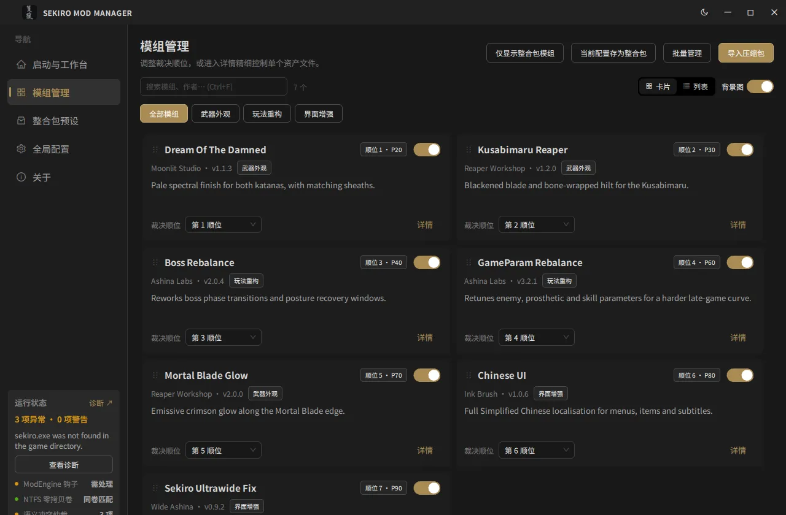
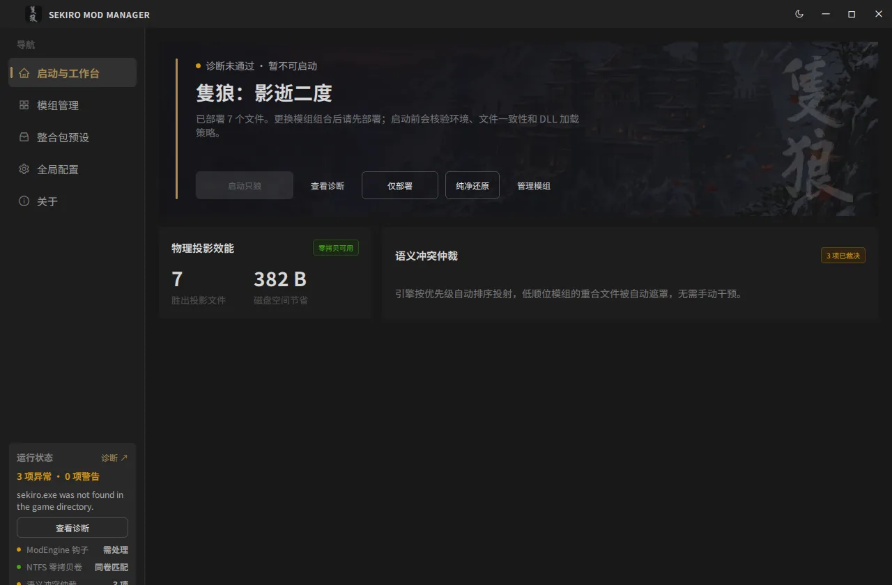
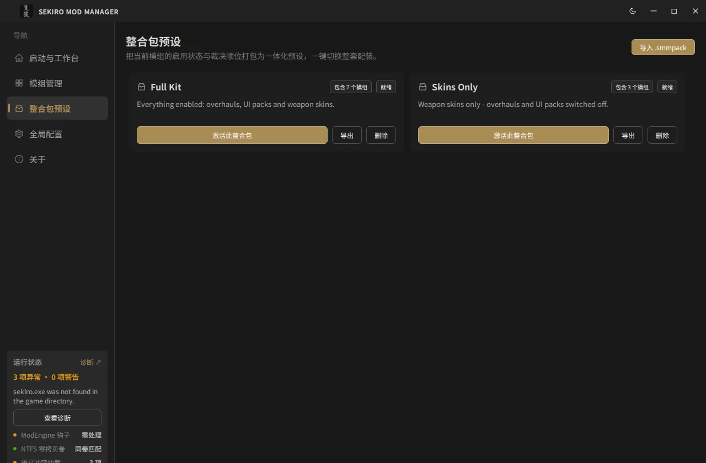
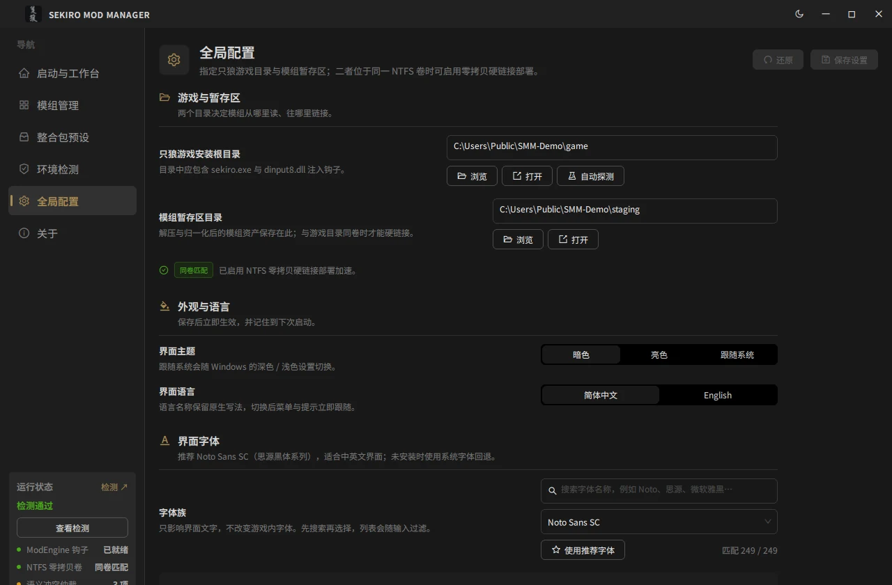
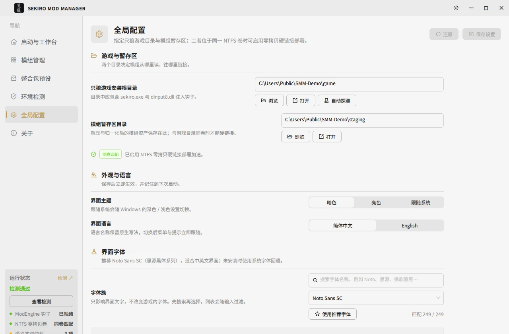
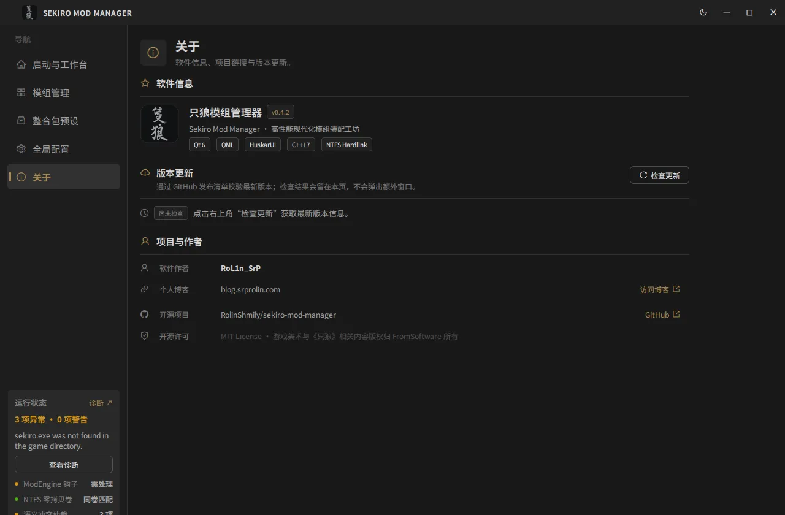

# 只狼模组管理器 (Sekiro Mod Manager · SMM)

专为《只狼：影逝二度》打造的模组暂存、语义冲突仲裁与 NTFS 零拷贝硬链接部署工具。

[English](README.md) | [简体中文](README.zh-CN.md) | [官网](https://sekiro.srprolin.com/) | [文档](docs/README.md)

---

## 项目简介

SMM 把模组留在独立的暂存区，只把生效的那部分用 **NTFS 硬链接**投射到游戏 `mods/` 目录：数十 GB 的高清贴图也是瞬间部署、不占额外磁盘，并且能一键还原成干净的游戏安装。同一个核心库支撑三个入口——原生 C++17 / Qt 6 QML 桌面端、独立 CLI、以及给智能体用的 Skill。

## 核心特性

| | |
|---|---|
| **零拷贝部署** | 同卷走 `CreateHardLinkW`；跨卷自动回退为复制并给出诊断提示。 |
| **纯净回滚** | 每次部署记录在 `.smm_manifest.json`，还原只删除 SMM 自己创建的文件与目录。 |
| **目录归一化** | 兼容 Nexus / 社区包的任意层级，最多递归解包 6 层，散落签名文件归入 `parts/`、`chr/`、`menu/font/`，并清理 `_yabber` / `_witchy` 等临时目录。 |
| **三级冲突仲裁** | 严重（平衡表）/ 警告（玩家与武器独占槽位）/ 提示（一般覆盖），按用户指定的裁决顺位自动决定胜出者。 |
| **整合包预设** | `.smmpack` 支持保存、应用、导出、导入，中英双语标题与描述。 |
| **资产级开关** | 可查看暂存模组里的单个文件并逐项开关，卡片支持背景图。 |
| **环境诊断** | 校验 `sekiro.exe`、ModEngine `dinput8.dll`、`modengine.ini` 注入参数与 NTFS 卷一致性，支持一键修复。 |
| **双语与主题** | 中英实时切换，深色 / 浅色 / 跟随系统。 |

## 界面



模组管理是日常停留最久的一屏：顺位（数字小的赢得共享文件）、逐模组开关、分类胶囊，以及点开详情抽屉的
冲突徽标。其余四屏：

<details>
<summary>启动与工作台 · 整合包预设 · 全局配置（深浅两套） · 关于</summary>

<table>
<tr>
<td></td>
<td></td>
</tr>
<tr>
<td><b>启动与工作台</b> —— 一句结论（已部署文件数、冲突数）加支撑它的证据。体检未通过时「启动只狼」置灰，不用点了才知道不行。</td>
<td><b>整合包预设</b> —— 「启用集合 + 顺位」的快照，一键切换整套配置，也能导出成 <code>.smmpack</code>。</td>
</tr>
<tr>
<td></td>
<td></td>
</tr>
<tr>
<td><b>全局配置</b> —— 游戏与暂存目录（同卷时提示零拷贝硬链接）、主题、语言与字体。每个设置项是两列：标签与说明在左，控件对齐在同一列宽上。</td>
<td><b>全局配置（浅色）</b> —— 同一套 token 而不是第二套配色；首屏画作上的按钮对比度就是在这里核对的。</td>
</tr>
</table>



</details>

所有截图都拍自 `scripts/local/seed_demo.ps1` 生成的虚构演示库，不是真实安装；可用
`scripts/local/capture_screenshots.ps1` 重新生成，说明见 [docs/design/screenshots.md](docs/design/screenshots.md)。

## 模块架构

```
                    smm_core   （C++17，不依赖 Qt，不负责打印）
                        ▲
          ┌─────────────┴─────────────┐
       smm.exe                     smm_gui.exe
       CLI + JSON 接口             Qt 6 / QML + HuskarUI
                                   controller → service → core
```

两个入口是互相独立的进程，链接同一个静态库。GUI 之上只有一层 Qt 专用适配层（`src/gui/backend/`）；参数解析、表格/JSON 输出与退出码属于 CLI。详见 [docs/architecture/layers.md](docs/architecture/layers.md)。

## 快速开始

环境要求：Windows 10/11 x64、Visual Studio 2022（MSVC v143）、CMake 3.25+、Qt 6.11.2、Python 3.9+（打包 Skill 与打 HuskarUI 补丁）。

```bash
git clone --recurse-submodules https://github.com/RolinShmily/sekiro-mod-manager.git
cd sekiro-mod-manager
cmake --preset msvc-x64-release && cmake --build --preset build-release
```

产物：`build/msvc-x64-release/src/cli/smm.exe` 与 `.../src/gui/smm_gui.exe`。各预设含义、增量构建、`core-only`（不需要 Qt）构建与常见故障：[docs/development/build.md](docs/development/build.md)。

## 常用命令

```bash
smm doctor                       # 环境与 ModEngine 健康检查
smm list                         # 暂存区模组、顺位、冲突
smm import ~/Downloads/mod.zip   # 导入压缩包或文件夹
smm plan && smm deploy           # 先看计划，再硬链接进 mods/
smm restore                      # 把游戏目录还原成纯净状态
```

完整命令、选项与退出码：[docs/reference/cli.md](docs/reference/cli.md)；`--json` 契约：[docs/reference/json-contract.md](docs/reference/json-contract.md)。

`smm.exe` 与桌面端一样声明 `requireAdministrator`。Windows 的 `CreateProcess` 弹不出 UAC，所以请在管理员终端里执行——普通终端里 `smm doctor` 会直接失败为 `ERROR_ELEVATION_REQUIRED`（740）且没有弹窗；`start smm ...` 能从普通终端提权，但输出进新窗口。

## 文档体系

索引在 [docs/README.md](docs/README.md)。

| 分册 | 内容 |
|---|---|
| [architecture/](docs/architecture/README.md) | 分层边界、GUI 后端角色、异步与线程模型、四条主链路、取舍记录。 |
| [design/](docs/design/README.md) | 设计 token、复用组件、无动效约定、双语与可达性。 |
| [development/](docs/development/README.md) | 环境与预设、书写规范、测试分层、分支与提交约定。 |
| [reference/](docs/reference/README.md) | CLI 参考、JSON 契约、错误码、磁盘格式、`smm_core` 头文件索引。 |

贡献者快速指引：[CONTRIBUTING.md](CONTRIBUTING.md)。

## 开源协议与版权声明

- 本项目源码采用 [MIT 许可证](LICENSE) 开源发布。
- 第三方组件、许可证全文与声明详见 [THIRD_PARTY_NOTICES.md](THIRD_PARTY_NOTICES.md) 与 [`licenses/`](licenses/)。
- 《只狼：影逝二度》(Sekiro: Shadows Die Twice) 是 FromSoftware, Inc. 与 Activision 的注册商标。本项目为玩家社区自主开发的开源工具，与 FromSoftware 或 Activision 无任何商业关联。
