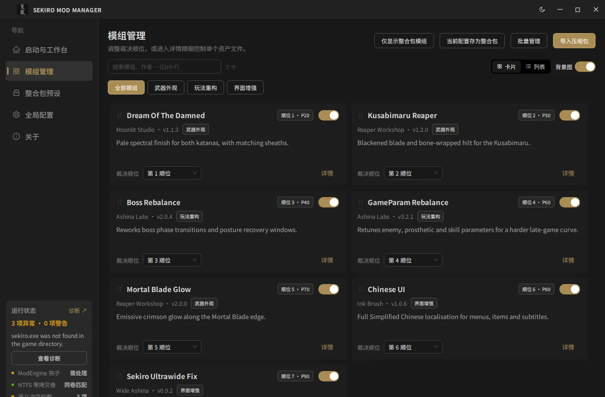
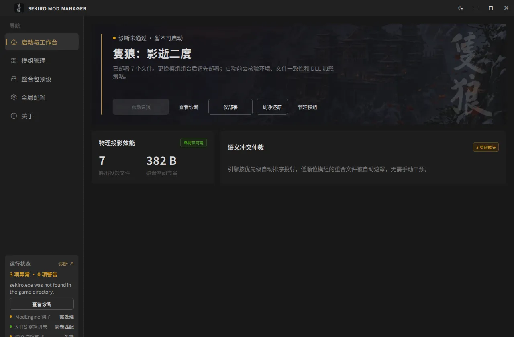
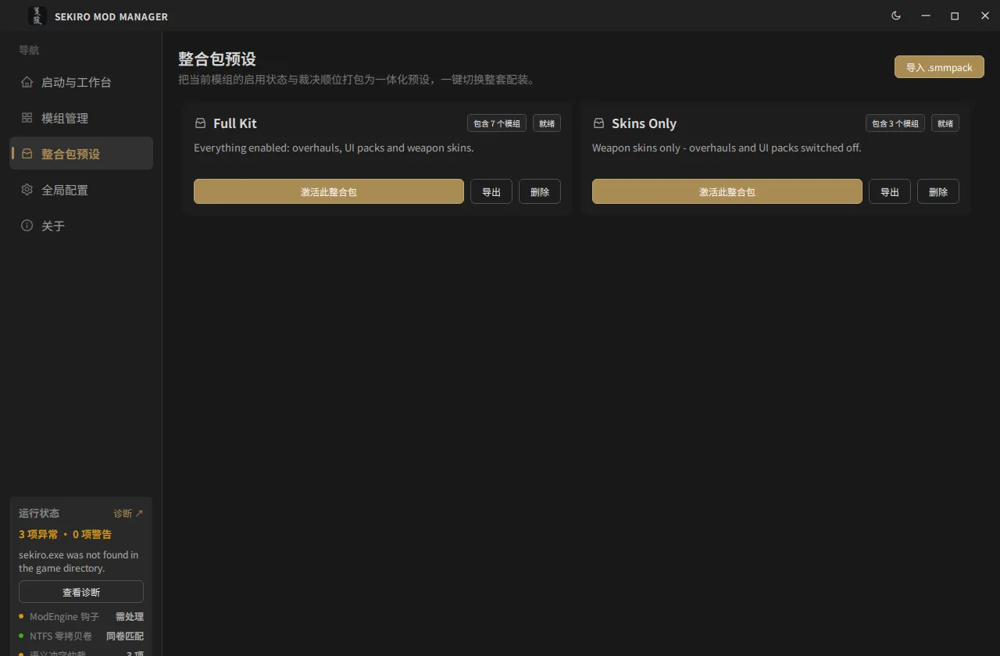
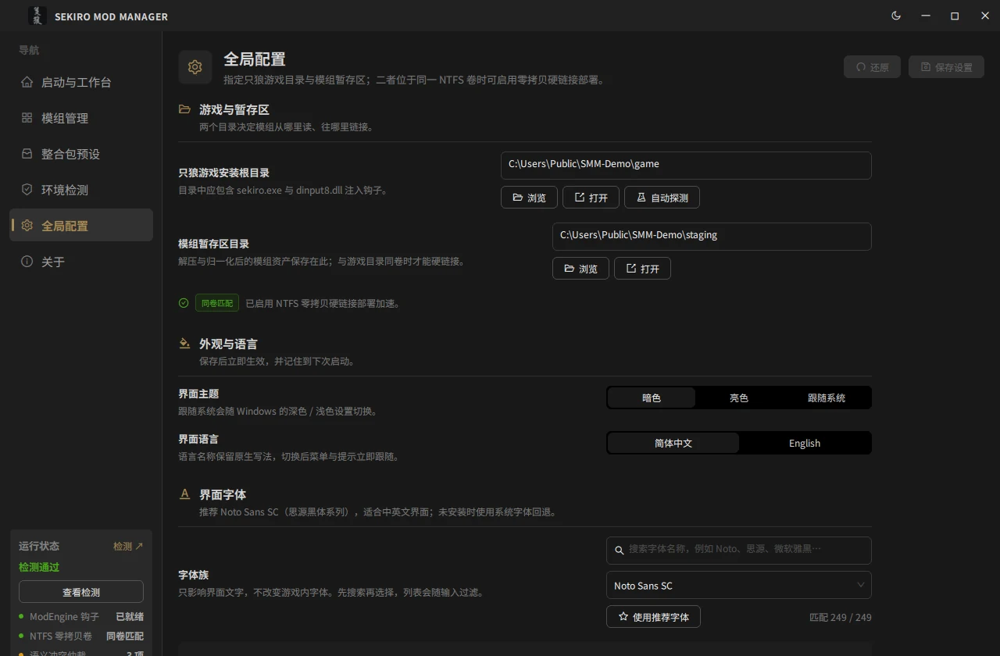
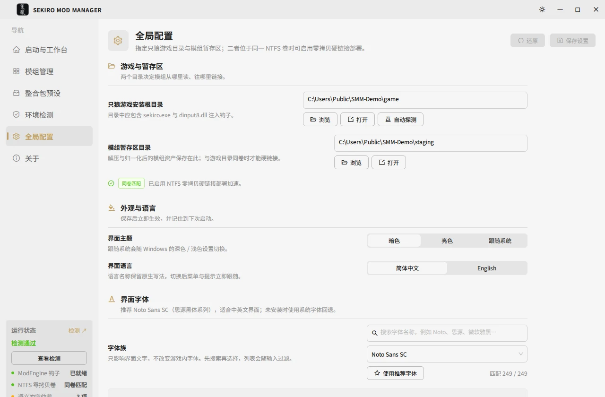
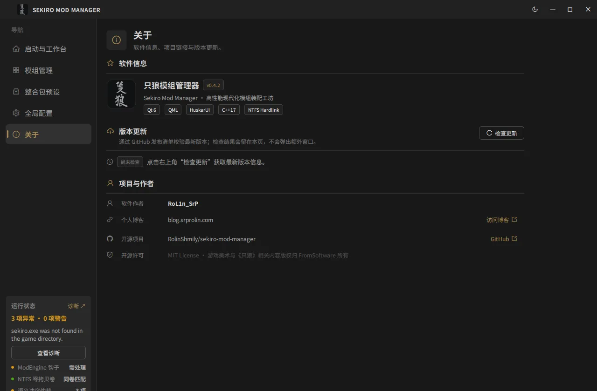

<h1 align="center">Sekiro Mod Manager · 只狼模组管理器</h1>

  <a href="README.md">English</a> | <b>简体中文</b>

  
  
  
  
  
  

  

更多截图 · 启动与工作台、整合包预设、全局配置（深浅主题）、关于

- **启动与工作台**：
- **整合包预设（`.smmpack`）**：
- **全局配置（深色 / 浅色）**： 
- **关于**：

**Sekiro Mod Manager (SMM)** 是专为《只狼：影逝二度》打造的原生 C++17 / Qt 6 Windows 桌面模组管理器。模组统一隔离在暂存区，仅通过 **NTFS 硬链接**投射到游戏 `mods/` 目录——零额外磁盘占用、秒级部署切换、一键纯净回滚。

- **零拷贝硬链接与纯净回滚**：同卷走 `CreateHardLinkW`（跨卷自动回退复制并提示），每次部署写入 `.smm_manifest.json`，一键还原不误伤游戏原文件。
- **自动归一化与三级冲突仲裁**：支持 `.zip` / `.7z` / `.rar` 与任意层级文件夹（最多 6 层递归解包），自动识别 `parts/`、`chr/`、`param/`、`menu/font/` 等目录结构；按优先级裁决「严重 / 警告 / 提示」三类文件冲突。
- **`.smmpack` 整合包预设**：将当前启用集合与顺位打包为可移植 `.smmpack` 一键导入切换；官网 [sekiro.srprolin.com](https://sekiro.srprolin.com/) 同时提供社区尝鲜整合包索引，方便新玩家快速体验。
- **内置环境诊断**：一键核验 `sekiro.exe`、ModEngine `dinput8.dll`、`modengine.ini`、暂存卷一致性与部署状态，支持自动修复。不修改游戏可执行文件。

## 使用方法

### 1. 下载并启动

从官网 [sekiro.srprolin.com](https://sekiro.srprolin.com/)（内置站内镜像加速 / GitHub 直连切换）或 [GitHub Releases](https://github.com/RolinShmily/sekiro-mod-manager/releases) 下载安装版（`setup.exe`）或便携版（`gui.zip`）。启动时会请求一次 UAC 管理员权限，以避免 Steam 的 `PreferSystem32` 策略拦截 ModEngine 的本地 `dinput8.dll`。

### 2. 导入、排序与排错

1. **设置与体检**：确认只狼安装目录与暂存区目录（建议置于同一 NTFS 分区以启用零拷贝硬链接），并在环境检测页确认 5 项检查通过。
2. **模组管理**：拖入或导入压缩包、文件夹或 `.smmpack` 整合包；逐模组或逐文件开关资产，调整裁决顺位（数字越小优先级越高），点击冲突徽标查看覆盖详情。
3. **整合包预设**：将当前搭配保存为预设或导出 `.smmpack`，随时整套切换。

### 3. 部署并启动

在「启动与工作台」点击 **部署** 或 **部署并启动**，SMM 会按 `.smm_manifest.json` 原子同步 `mods/` 并启动游戏；需要恢复原版时点击 **还原纯净** 即可。

> **关于 ModEngine**：SMM 仅检测与修补 `modengine.ini`，**绝不内置或再分发 `dinput8.dll`**。请自行从 [Nexus Mods #6](https://www.nexusmods.com/sekiro/mods/6) 获取原版 ModEngine。

## 文档

| 文档 | 内容范围 |
| :--- | :--- |
| [`docs/architecture.md`](docs/architecture.md) | 仓库分层边界、平铺 `src/core`、GUI 后台线程模型、Worker 反代与 R2 整合包架构 |
| [`docs/design.md`](docs/design.md) | 桌面端界面骨架、HuskarUI 主题 Token、预览图加载、双语本地化与截图规范 |
| [`docs/reference.md`](docs/reference.md) | 磁盘契约（`.smm_mod.json` / `.smmpack` / `.smm_manifest.json`）、`ErrorCode` 全表与 `smm_core` 接口 |
| [`docs/development.md`](docs/development.md) | 本地编译、统一 `tests/` 测试、打包脚本、CI/CD（`test`/`build`/`release`/`deploy`）与官网开发 |

另见 [`CONTRIBUTING.md`](CONTRIBUTING.md)、[`THIRD_PARTY_NOTICES`](THIRD_PARTY_NOTICES) 与 [`CHANGELOG.md`](CHANGELOG.md)。

## 开源许可与免责声明

本项目自有代码与文档基于 **[MIT License](LICENSE)** 开源发布，Copyright (c) 2025–2026 **RoL1n_SrP**。第三方组件完整许可文本及合规边界详见 [`THIRD_PARTY_NOTICES`](THIRD_PARTY_NOTICES)。

*《只狼：影逝二度》(Sekiro: Shadows Die Twice) 是 FromSoftware, Inc. 与 Activision 的注册商标。本项目为独立开源社区工具，与上述公司无任何关联或背书。任何第三方社区 Mod 及官网展示的可选社区 `.smmpack` 尝鲜整合包均归原作者所有并遵循其原始授权条款；如涉及署名更新或下架请求，请通过 Issue 联系处理。*
