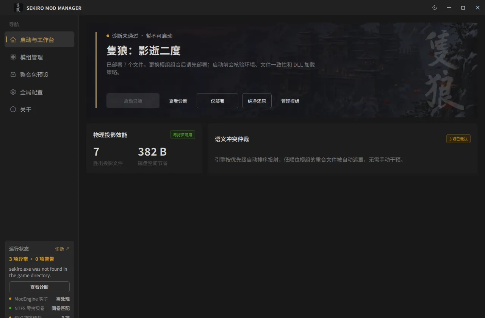
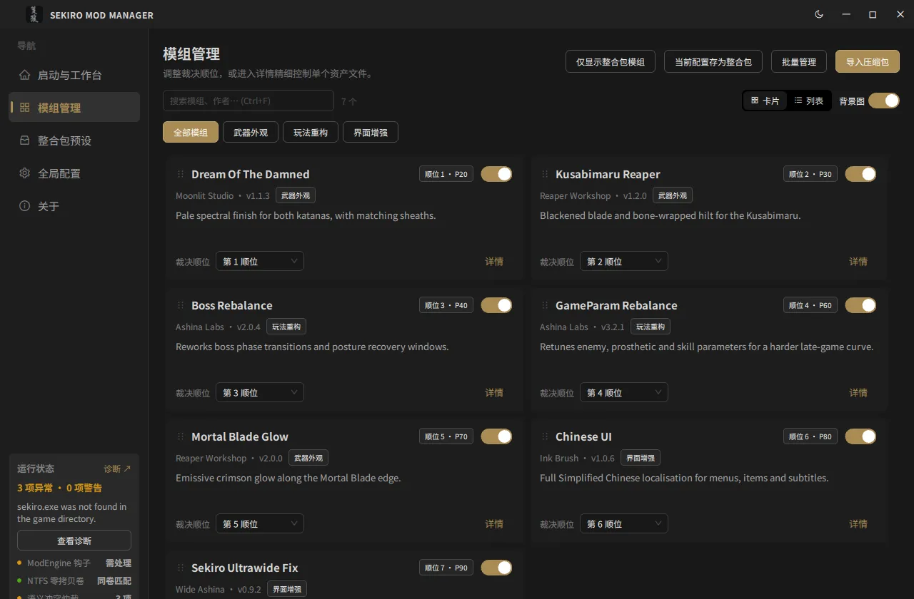
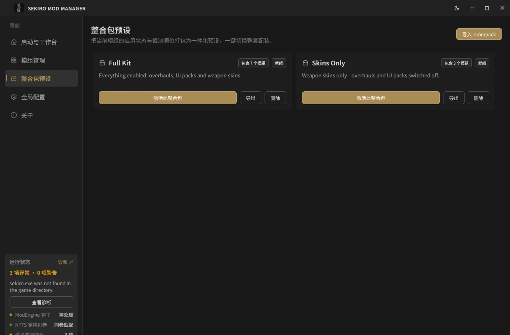
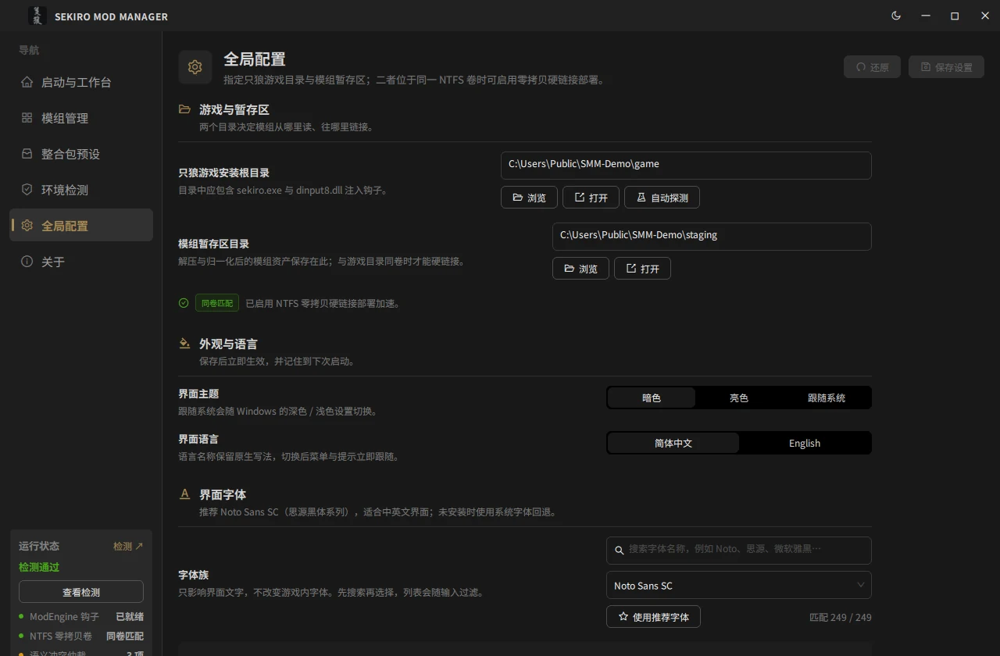
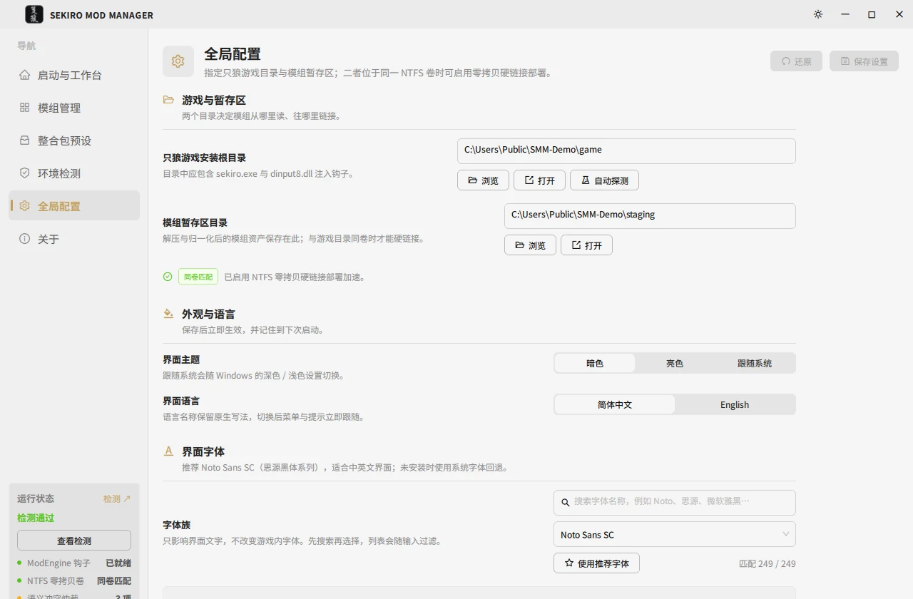
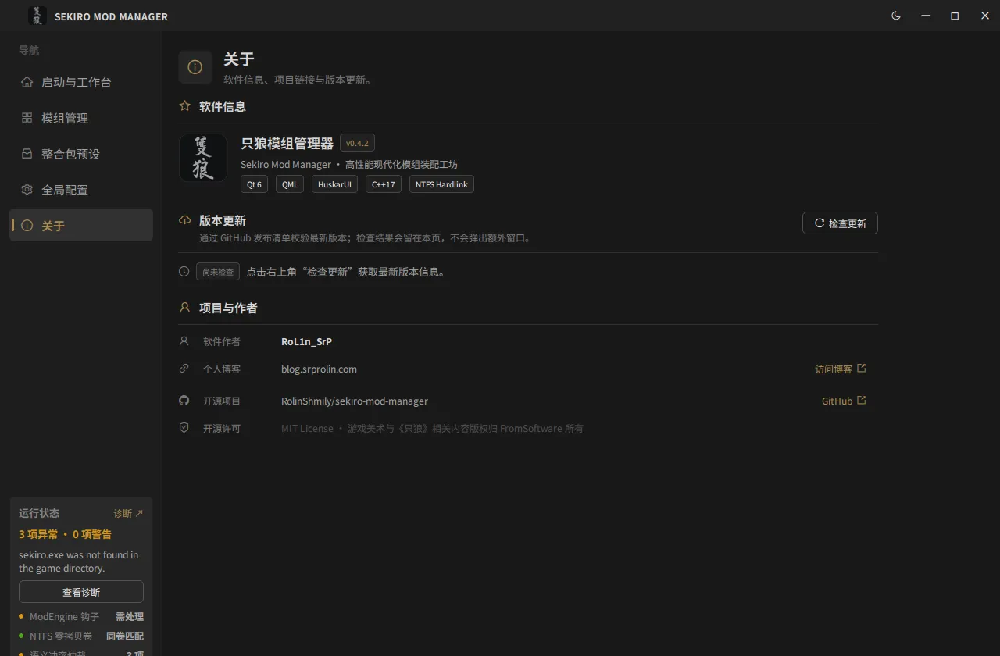
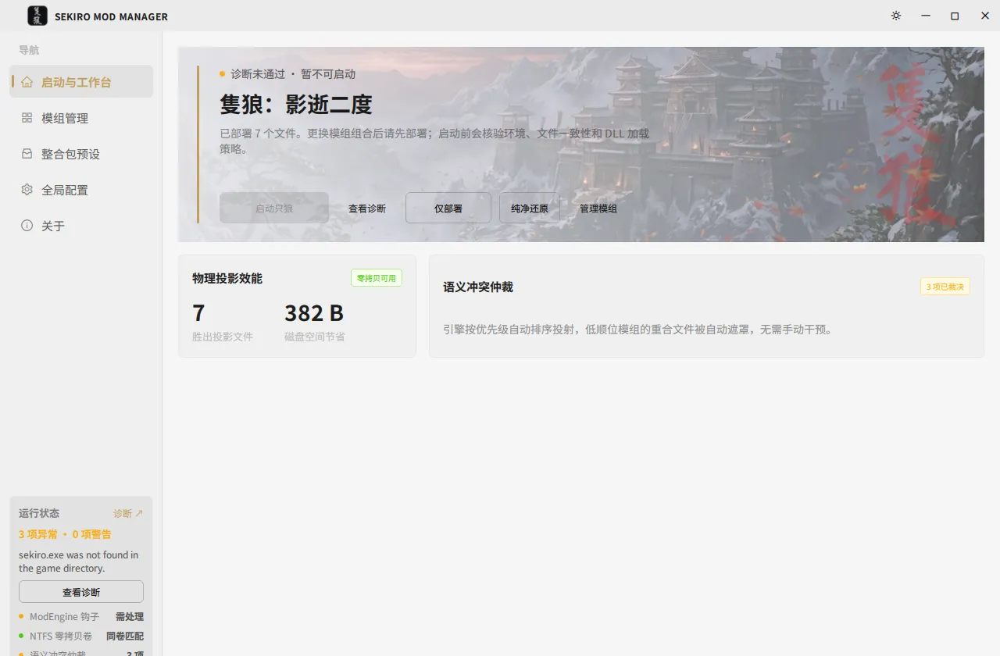

# 界面实拍

页面骨架、token 与组件规范见本分册其余文档；这一页只回答"它现在长什么样"。

所有截图来自 `scripts/local/seed_demo.ps1` 播种的演示库（7 个示例模组、3 处冲突、2 个预设），
不含任何真实用户的模组或路径。客户区 1280×840（脚本按 `Main.qml` 的窗口尺寸裁剪，去掉缩放边框），
WebP q80，7 张合计约 270 KB。

## 启动与工作台



首屏把"能不能启动"放在最前面：左侧强调条 + 状态点 + 一句人话（检测通过 / 启动前会先检测环境），
然后才是主操作。点击「启动只狼」才会跑那五项检测；上次检测有提示时，「查看检测」就出现在主按钮旁边。

## 模组管理



卡片视图：一张卡片同时给出裁决顺位、启用开关、分类、来源徽标、资产数与尺寸。
顶部两行工具栏分别是全局动作与搜索/视图控制，分类胶囊单独一行并自动换行，不会被挤到画面外。

## 整合包预设



每个预设一张卡：名称、包含模组数、当前是否已装配；已装配的那张用边框与「取消整合包应用」区分。

## 全局配置



分页后的设置页：页头（图标 + 标题 + 还原/保存）+ 四组平铺内容（游戏与暂存区 / 外观与语言 /
界面字体 / 动效）。分组靠图标、标题、细分隔线与留白，不再在背景上另开一层卡片。
「还原」与「保存设置」只在有改动时启用。



同一页面的浅色主题，验证 token 而不是两套硬编码颜色。

## 关于



软件信息、版本更新（内联检查结果，不弹窗）、项目与作者；每行用图标区分作者、博客、仓库、许可。

## 浅色主题的首屏



首屏是明亮画作，是最容易暴露对比度问题的地方：描边按钮在这里几乎没有边界，所以「纯净还原」
用默认按钮、文本按钮跟随正文色，而不是主色。

## 重新生成

一条命令即可（脚本自己播种、启动、切页、按客户区裁剪）：

```powershell
# 深色
powershell -ExecutionPolicy Bypass -File scripts/local/capture_screenshots.ps1
# 浅色（输出带 -light 后缀，不覆盖深色图）
powershell -ExecutionPolicy Bypass -File scripts/local/capture_screenshots.ps1 -Theme light
```

几点约定：

- 脚本输出 PNG（1280×840）；提交前转成 WebP q80 再删掉 PNG，仓库里只保留 WebP：
  `magick shot.png -quality 80 shot.webp`（或任意转换工具）。
- 脚本不改任何用户设置：它把两个目录作为 `--staging=<path> --game-dir=<path>` 传给 GUI，GUI 只对
  该进程生效、不写回 QSettings，所以 `HKCU\Software\SekiroModManager\SMM` 从头到尾不被读写。
- 需要交互式桌面会话：PrintWindow 需要真实窗口站；无头环境只能用 mock。
- 演示库的 `game/` 里没有真正的游戏与 ModEngine。若希望截图呈现"诊断通过"，需在演示游戏目录放
  一个 `sekiro.exe` 占位文件与 ModEngine payload（`dinput8.dll` ≥ 10 KB、`modengine.ini`）——
  这只是截图夹具，绝不要用于真实安装。
